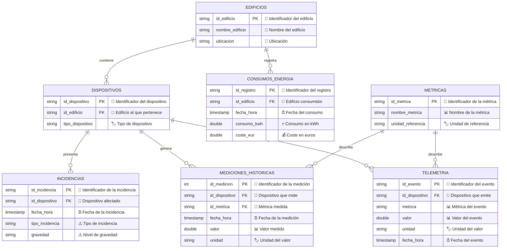

# Reto 2 — Observación de telemetría (BDA 26-27)

Equipo de 4 personas: una fuente por integrante. Responsable de JSONL: [pendiente de nombre].

## Fuentes verificadas (25 nov 2026)

- PostgreSQL REST: hadoop-master1.tartangalh.eus:3000 — CAÍDA (ConnectionRefused).
- Kafka: hadoop-master1.tartangalh.eus:9092 — topic ethazi_telemetria, 3 particiones.
- CSV en HDFS: /ethazi/fuentes/csv — 85 ficheros, edificios E001-E003.
- JSONL en HDFS: /ethazi/fuentes/json — 85 ficheros, dispositivos S001-S005.

Usar siempre el FQDN: "hadoop-master1" no resuelve. El análisis detallado está en
ANALISIS_FUENTES.md, que no se versiona.

## Convenciones

UTC · ids canónicos · Bronze byte-a-byte · Parquet+Snappy · partición dt por fecha de evento ·
los originales permanecen en HDFS sin modificar.

## Estructura

- src/ = código real (fuente de verdad); ingest/ lleva un .py por fuente.
- notebooks/ = vacío por ahora. Se creará un .ipynb por fuente/capa cuando se confirme
  el entorno (Zeppelin o Jupyter). La lógica real vive en src/*.py; el notebook solo
  importa y demuestra. Limpiar los outputs antes de commit.
- dags/ = Airflow; sql/ = DDL/HQL de Hive; configs/ = umbrales y crosswalk de métricas.
- data/ = espejo local del lake (bronze, silver, gold), ignorado salvo samples/.
  El lake auténtico está en HDFS: /ethazi/bronze, /ethazi/silver, /ethazi/gold.
- docs/ = memoria acumulativa, arquitectura y evidencias de cada hito.

## Modelo de datos

Modelo entidad-relación de las cuatro fuentes verificadas. Los nombres de campo siguen el
dibujo original de `docs/arquitectura/`; la tabla siguiente los mapea a los campos reales de
cada fuente, que son la fuente de verdad.

Mapeo de cada campo del diagrama al campo real verificado en su fuente:

| Entidad del diagrama | Campo del diagrama | Campo real en la fuente |
| --- | --- | --- |
| EDIFICIOS | `id_edificio` | `id_edificio` (API, string) |
| EDIFICIOS | `nombre_edificio` | `nombre` (API) |
| EDIFICIOS | `ubicacion` | `ubicacion` (API) |
| DISPOSITIVOS | `id_dispositivo` | `id_dispositivo` (API, string) |
| DISPOSITIVOS | `id_edificio` | `id_edificio` (API, FK) |
| DISPOSITIVOS | `tipo_dispositivo` | `tipo` (API) |
| METRICAS | `id_metrica` | `id_metrica` (API, string) |
| METRICAS | `nombre_metrica` | `nombre` (API) |
| METRICAS | `unidad_referencia` | `unidad_referencia` (API) |
| MEDICIONES_HISTORICAS | `id_medicion` | `id_medicion` (API, entero) |
| MEDICIONES_HISTORICAS | `id_dispositivo` | `id_dispositivo` (API, FK) |
| MEDICIONES_HISTORICAS | `id_metrica` | `id_metrica` (API, FK) |
| MEDICIONES_HISTORICAS | `fecha_hora` | `fecha` (API, TIMESTAMP) |
| MEDICIONES_HISTORICAS | `valor` | `valor` (API, DOUBLE) |
| MEDICIONES_HISTORICAS | `unidad` | `unidad` (API) |
| CONSUMOS_ENERGIA | `id_registro` | `id_registro` (CSV, STRING) |
| CONSUMOS_ENERGIA | `id_edificio` | `id_edificio` (CSV, FK STRING) |
| CONSUMOS_ENERGIA | `fecha_hora` | `fecha` (CSV, TIMESTAMP) |
| CONSUMOS_ENERGIA | `consumo_kwh` | `consumo_kwh` (CSV, DOUBLE) |
| CONSUMOS_ENERGIA | `coste_eur` | `coste_eur` (CSV, DOUBLE) |
| INCIDENCIAS | `id_incidencia` | `id_incidencia` (JSONL, STRING) |
| INCIDENCIAS | `id_dispositivo` | `id_dispositivo` (JSONL, FK STRING) |
| INCIDENCIAS | `fecha_hora` | `fecha` (JSONL, TIMESTAMP) |
| INCIDENCIAS | `tipo_incidencia` | `tipo` (JSONL, STRING) |
| INCIDENCIAS | `gravedad` | `gravedad` (JSONL, STRING) |
| TELEMETRIA | `id_evento` | sin confirmar: el brief no especifica ID de evento |
| TELEMETRIA | `id_dispositivo` | `id_dispositivo` (Kafka, según brief) |
| TELEMETRIA | `metrica` | `métrica` (Kafka, según brief) |
| TELEMETRIA | `valor` | `valor` (Kafka, según brief) |
| TELEMETRIA | `unidad` | `unidad` (Kafka, según brief) |
| TELEMETRIA | `fecha_hora` | `fecha` (Kafka, según brief) |

> **Nota:** `TELEMETRIA` refleja el esquema del brief (`id_dispositivo`, `métrica`, `valor`,
> `unidad`, `fecha`), pendiente de confirmar contra un evento real; sus nombres exactos,
> incluido `id_evento`, no están verificados. Según el dibujo original,
> `MEDICIONES_HISTORICAS` y `TELEMETRIA` tienen los mismos seis campos y tipos: su unificación
> con un campo `origen` está valorada en Silver y pendiente de decisión.

Imagen suplementaria: [diagrama-entidad-relacion.png](docs/arquitectura/diagrama-entidad-relacion.png).

## Enlaces del proyecto

- Repo GitHub: https://github.com/mikelrh-dev/observacion-telemetria
- Project Kanban: https://github.com/users/mikelrh-dev/projects/4

## Estado

Repo local y GitHub público. Project de GitHub creado, vinculado al repo y configurado
con 9 hitos (7 fases) y sus fechas. Airflow pendiente. GitHub con incidencias el 25 nov.

## Pendiente

API REST del puerto 3000, permisos HDFS de escritura, leer un evento real de Kafka
y obtener el usuario de GitHub del profesor para darle acceso al Project.
